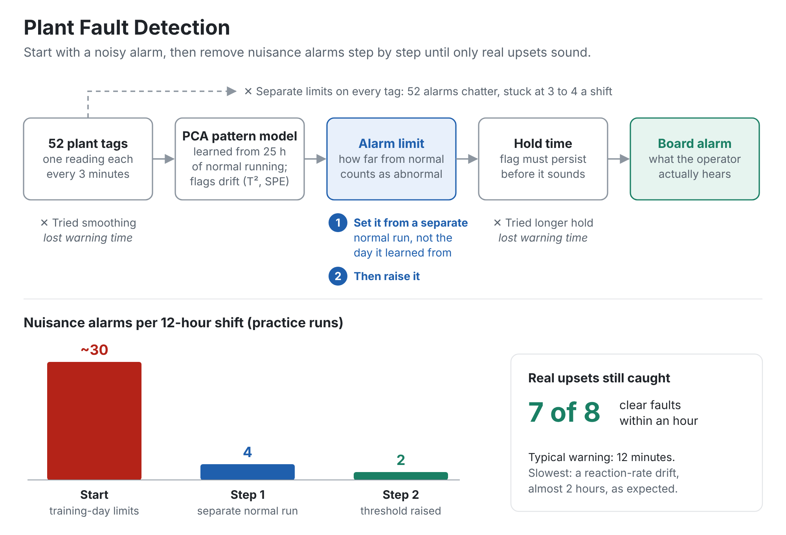

# Plant Fault Detection

**A fault detector on the Tennessee Eastman benchmark plant that started out giving 30 nuisance alarms a shift. This repo shows the steps I took to cut that to about 3 a shift while it still catches the real upsets, with every step measured.**


## Why I built it

I'm Nathan Ramos. I ran chemical process units for more than ten years at NOVA Chemicals, CF Industries, INEOS Styrolution and GreenMantra, and I hold a TSSA 3rd Class Operating Engineer certificate. A detector that alarms thirty times a night gets tuned out, and then it doesn't matter how good the model is. So I judged this one the way the board judges it: how many nuisance alarms it gives per shift, and how many minutes a real upset runs before the alarm comes in.

## How it works

<picture>
  <source media="(prefers-color-scheme: dark)" srcset="docs/plant-fault-detection-dark.png">
  
</picture>

## The steps

The detector is PCA monitoring. It learns how the plant's 52 measured tags normally move together, then alarms when that pattern breaks. Every step below was measured on the practice half of the runs:

| Step | Nuisance alarms per shift | Normal hours with an alarm | Median minutes to alarm | Faults caught within 1 h |
|---|---:|---:|---:|---:|
| 1. Textbook: limits set from the training day | 29.2 | 97% | 2 | 8 of 8 |
| 2. Limits set from a separate normal run | 4.4 | 25% | 4 | 7 of 8 |
| 3. Same, limit raised to the 99.5th percentile | 2.1 | 12% | 12 | 7 of 8 |
| 4. Same, limit raised to the 99.9th percentile | 0.8 | 6% | 24 | 7 of 8 |

"Normal hours with an alarm" is how often a random hour of normal running already has an alarm in it, which is roughly the chance that a "caught within 1 h" is luck. At step 1 that's almost certain, so its 8 of 8 means very little. At step 4 it's 6%.

**Step 2 is the big one.** The textbook method sets the alarm limits from the same 25 hours the model learned from. A model always looks calmer on its own training data, so those limits are far too tight for any new day. Setting them from a separate 24-hour normal run instead cut nuisance alarms by about 85%. It's the same lesson as setting plant alarm limits from one quiet week.

**Steps 3 and 4 trade warning time for quiet.** I picked step 3, the balanced one. Step 4 is quieter by about one nuisance alarm a shift, but it doubles the typical wait, and missing an upset is worse.

The fault that slips past an hour is fault 13, a slow drift in reaction kinetics. It takes almost two hours to show up in the data, which is what you'd expect from a drift.

### What I tried and didn't keep

| Tried | Nuisance alarms per shift | Median minutes to alarm | Faults caught within 1 h | Why not |
|---|---:|---:|---:|---|
| Smoothing the readings (EWMA) | 1.4 | 12 | 6 of 8 | Noisier than step 4 and catches fewer |
| A 6-minute hold before alarming | 0.1 | 30 | 6 of 8 | Quiet, but loses a fault inside the hour |
| Simple high/low limits on each tag, quietest that still catches 7 of 8 | 4.1 | 8 | 7 of 8 | 52 separate alarms always chatter |

The last row is why the detector watches the pattern instead of every tag: with 52 tags, some tag is always near its limit by chance.

## Suggested alarm points, read backwards from the history

A plant doesn't have a labelled "normal" day. What it has is a historian full of mixed running. So `python run.py suggest` reads history backwards to find the real zone of normal operation, with no labels:

1. It starts from the most typical 75% of samples, fits the pattern model, flags anything outside its limits for 9 minutes as an upset, and drops it with a margin either side.
2. It refits on what's left and repeats until the normal zone stops changing.
3. From that zone it suggests a high and low alarm point for each of the 52 tags, at the 0.1st and 99.9th percentile of normal running plus 10% of the normal span.
4. It keeps an alarm only on tags that actually fired in at least 2 of the upsets it found. That's the rationalization step: a tag whose alarm never helped doesn't get one.

The history is 181 h stitched from the practice runs, with 11 upsets in it. The labels are used only to check the result:

| Check | Result |
|---|---|
| Real upsets clearly found (over a quarter of the upset flagged) | 7 of 11. That includes fault 3, which the literature treats as undetectable, so at least one find is likely chance. |
| False upsets flagged in normal running | 2 |
| Upset samples from the clear faults that it caught | 71% |
| Normal running kept in the normal zone | 95% |
| Normal zone that was really an upset | 12.2%. Half of that is faults 3, 9 and 15, which look like normal running anyway. |
| Tags kept with an alarm | 40 of 52 |

The command `python run.py report` scores these on the held-back runs. The full list is in [docs/suggested-alarms.csv](docs/suggested-alarms.csv). For each tag it shows the suggested low and high, how often the alarm would have come in during normal history, and how many past upsets it fired in. These are the tags that fired in the most upsets:

| Tag | Name | Suggested low | Suggested high | Upsets it fired in | Keep |
|---|---|---:|---:|---:|---|
| XMEAS(21) | Reactor cooling water outlet temp | 94.15 | 95.04 | 7 | yes |
| XMEAS(11) | Separator temperature | 79.39 | 80.83 | 6 | yes |
| XMEAS(20) | Compressor work | 337.1 | 346.4 | 6 | yes |
| XMEAS(22) | Separator cooling water outlet temp | 76.35 | 78.24 | 6 | yes |
| XMEAS(38) | Product analysis E | 0.786 | 0.8807 | 6 | yes |
| XMV(5) | Compressor recycle valve | 20.67 | 23.87 | 6 | yes |
| XMV(10) | Reactor cooling water valve | 39.14 | 43.06 | 6 | yes |
| XMEAS(7) | Reactor pressure | 2682 | 2724 | 5 | yes |

On the held-back runs, alarming on the first 3-minute sample:

| Per-tag alarm points | Nuisance alarms per shift | Median minutes to alarm | Faults caught within 1 h |
|---|---:|---:|---:|
| Textbook (training day ± 3σ) | 17.2 | 6 | 9 of 10 |
| Suggested from history, 40 tags kept | 4.2 | 14 | 9 of 10 |

Treat this table with more caution than the rest of the results. I looked at a few versions of this method on the held-back runs while I was still developing it, so these numbers were seen during development and aren't a clean first look.

## Results on the held-back runs

Scored once, after the setting was locked at step 3. There are 10 faults over 104 h of normal running:

| Detector | Nuisance alarms per shift | Normal hours with an alarm | Median minutes to alarm | Faults caught within 1 h |
|---|---:|---:|---:|---:|
| Before: textbook PCA | 30.7 | 97% | 0 | 10 of 10 |
| **After: limits from a separate run, 99.5th pct** | **3.5** | **21%** | **20** | **10 of 10** |
| Per-tag limits, quietest from the practice runs | 6.7 | 37% | 8 | 9 of 10 |
| Per-tag alarm points suggested from history | 4.2 | 25% | 14 | 9 of 10 |

**Nuisance alarms fell 89%, and every fault was still caught within an hour.** The "before" detector's instant catches mean little, because its alarm is sounding in almost every hour of normal running anyway. The held-back runs came out noisier than the practice runs (3.5 a shift against 2.1), which is the usual drop when a result meets new data. A one-in-five chance that a random hour has an alarm in it is still more than a board would like, so the next step is a longer, more varied calibration history.

| Fault | What changes | Before | After | Per-tag | From history |
|---|---|---:|---:|---:|---:|
| 2 | B composition step | 0 min | 33 min | 15 min | 30 min |
| 4 | Reactor cooling water inlet temp step | 0 min | 0 min | 0 min | 0 min |
| 6 | A feed loss | 0 min | 0 min | 0 min | 0 min |
| 8 | A, B, C feed composition random | 27 min | 45 min | 21 min | 21 min |
| 10 | C feed temperature random | 0 min | 54 min | 24 min | 36 min |
| 12 | Condenser cooling water inlet temp random | 3 min | 6 min | 6 min | 6 min |
| 14 | Reactor cooling water valve sticking | 0 min | 0 min | 0 min | 0 min |
| 16 | Unknown | 0 min | 3 min | 0 min | 0 min |
| 18 | Unknown | 0 min | 51 min | 9 min | 42 min |
| 20 | Unknown | 18 min | 39 min | 141 min | 201 min |

Fault 20 is where watching the pattern pays off: PCA hears it in 39 minutes, while per-tag alarms take 2 to 3 hours.

## How it's tested

- The model learns from 25 h of normal operation and never sees a fault while it's being fitted. That matches a real plant, where there's plenty of normal history and very few labelled upsets.
- A separate 24 h normal run sets the alarm limits. It's never used for scoring.
- **The test runs are split in two.** I made every choice on the odd-numbered faults. The even-numbered faults and the last 24 h of normal running were held back and scored once, after the settings were locked in `config.py`. `run.py report` refuses to run until they are.
- A nuisance alarm counts once each time it comes in during normal running, because that's what the operator hears. A detection is the first sample after the fault starts with the alarm sounding. Some detections are luck, because a nuisance alarm can land in the first hour by chance, so every table also shows how often a random normal hour has an alarm in it.
- Faults 3, 9 and 15 barely move any measured tag, and the literature treats them as practically undetectable. They're listed but left out of the medians.

## Run it

```powershell
python -m venv .venv
.\.venv\Scripts\Activate.ps1
pip install -r requirements.txt
python run.py download     # about 18 MB of benchmark data into data/
python run.py steps        # the table above
python run.py tradeoff     # every setting tried
python run.py suggest      # alarm points per tag, read from the history
python run.py report       # the held-back results
python run.py chart        # redraws docs/fault-example.png
python -m pytest -q
```

## History

- **Version 1** used the loosest textbook limits, chosen on the rule "Missing an upset is worse." It caught everything, but it gave 17 to 31 nuisance alarms a shift on the held-back runs. That result is why version 2 exists. Version 2 keeps the same rule and fixes where the limits come from. So the held-back runs have now been scored twice, once for each version.

## How this was built

I wrote the code with AI coding agents working under my direction. I chose the problem, the operator-facing metrics, the dev/report split, and which steps to keep. I picked the final setting myself from the practice runs, before the held-back numbers existed.

## Limits

- This is a simulation. Real tags have bad values, frozen transmitters, maintenance bypasses and mode changes, and this benchmark has none of them.
- Each fault has one run, so the medians move if a single fault changes.
- The detector only says that something is wrong, not what is wrong. Ranking which tags contributed most is the next step.
- A real plant would set limits from weeks of history across rates and seasons, not from one extra day.
- The history reader sets its limits from the same data it fits on, which is the step-1 mistake in miniature. That makes it drop a little too much as upset, a cautious error, but still an error.

## Data

The data is the Tennessee Eastman set distributed by the Braatz group (Chiang, Russell and Braatz, *Fault Detection and Diagnosis in Industrial Systems*, 2001), based on Downs and Vogel (1993). It's downloaded from the public mirror at `github.com/camaramm/tennessee-eastman-profBraatz` and isn't stored in this repo. Samples are 3 minutes apart.

## Also by me

- [Operator RAG Assistant](https://github.com/nrvmos/operator-rag-assistant): answers from operating documents with citations, and refuses when it shouldn't answer.
