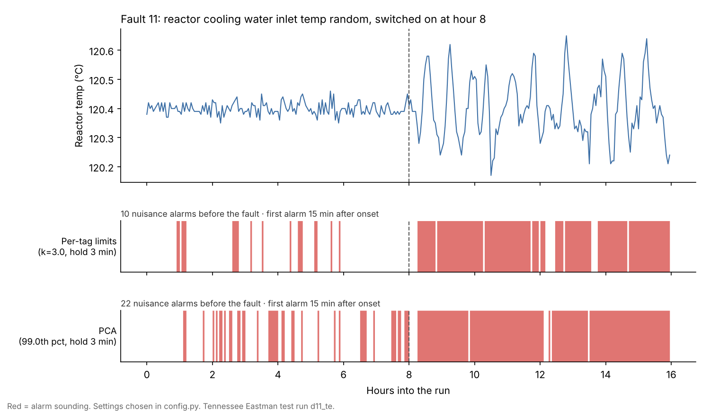

# Plant Fault Detection

**Two fault detectors run on the Tennessee Eastman benchmark plant and get judged the way a board operator would judge them: how many nuisance alarms they give per shift, and how many minutes a real upset runs before the alarm comes in.**



## Why I built it

I'm Nathan Ramos. I ran chemical process units for more than ten years at NOVA Chemicals, CF Industries, INEOS Styrolution and GreenMantra, and I hold a TSSA 3rd Class Operating Engineer certificate. Most fault-detection results are reported as accuracy, but that's not how the control room judges a detector. If it gives fifteen nuisance alarms a night, operators stop listening, and then it doesn't matter how good the model is. So this project scores detectors on the two numbers that decide whether operators keep listening.

## What's compared

- **Baseline: per-tag limits.** Every one of the 52 measured tags gets a high and low alarm at its normal mean plus or minus k standard deviations. This is roughly how a lot of plants alarm today.
- **Model: PCA monitoring.** It learns how the 52 tags normally move together, then alarms when the overall pattern drifts (Hotelling T²) or when the tags stop agreeing with each other (SPE). This is the standard multivariate method.
- **The operator's tool: an on-delay.** A flag has to hold for a set time before the alarm sounds, which is the same setting a DCS alarm uses.

## How it's tested

- Both detectors learn from **normal operation only**: 25 h of normal data. Neither sees a fault while it's being fitted. That matches a real plant, where there's plenty of normal history and very few labelled upsets.
- Each test run is 48 h long, with the fault switched on at hour 8. The first 8 h of every run count toward false alarms.
- **The test runs are split in two.** The odd-numbered faults and the first 24 h of the normal test run form the *dev* split, which is where the alarm settings get chosen. The even-numbered faults and the last 24 h form the *report* split, which is only scored once the settings are locked in `config.py`. `run.py report` refuses to run until they are.
- A false alarm counts once each time an alarm comes in during normal running, which is what the operator actually hears. A detection is the first sample after the fault starts with the alarm sounding, which is the usual benchmark definition. That means an alarm that happened to be sounding already counts, so the report also shows how much of normal running the alarm is on.
- Faults 3, 9 and 15 barely move the measured tags, and the literature treats them as practically undetectable. They're still listed, but they're left out of the medians.

## What the dev split shows

Rows from `python run.py tradeoff` (8 clear faults over 112 h of normal running):

| Detector | Flag must hold | Nuisance alarms per shift | Median minutes to alarm | Faults caught within 1 h |
|---|---:|---:|---:|---:|
| Per-tag, k=3 | 3 min | 17.8 | 8 | 8/8 |
| Per-tag, k=4 | 3 min | 0.32 | 10 | 6/8 |
| Per-tag, k=3.5 | 9 min | 0.43 | 16 | 5/8 |
| PCA, 99th pct | 3 min | 29.9 | 2 | 8/8 |
| PCA, 99.9th pct | 9 min | 0.86 | 15 | 7/8 |
| PCA, 99.9th pct | 15 min | 0.11 | 51 | 4/8 |

1. **Limits set on one good day don't hold up.** Both detectors were tuned to flag 1% of the training data, but new normal runs flag far more often than that. Textbook settings give 18 to 30 nuisance alarms a shift, which is the same thing that happens when a plant sets its alarm limits from one quiet week.
2. **The on-delay matters as much as the model.** Holding a flag for 9 minutes cuts nuisance alarms by four to ten times.
3. **At an alarm rate an operator would accept, the two are close.** With under one nuisance alarm a shift, PCA catches 7 of 8 faults within an hour at 0.86 alarms a shift, and per-tag limits catch 6 of 8 at 0.32. Eight faults are too few to call that a win for either one.

## The alarm settings (my call)

I picked the loosest settings for both detectors: per-tag limits at k=3 and PCA at its 99th percentile, with each flag alarming on the first 3-minute sample.

> **Missing an upset is worse.**

That's a deliberate trade. These settings catch every clear fault on the dev split within an hour, and they pay for it with 18 to 30 nuisance alarms a shift. A board operator lives with that cost, and the next step would be deciding which tags deserve tighter handling, so the noise comes down without losing the early warning.

## Results on the report split

Scored once, after the settings were locked. There are 10 faults over 104 h of normal running.

| Detector | Nuisance alarms per shift | Alarm sounding in normal running | Median minutes to alarm | Faults caught within 1 h |
|---|---:|---:|---:|---:|
| Per-tag limits (k=3, 3 min) | 17.2 | 21% of the time | 6 | 9/10 |
| PCA (99th pct, 3 min) | 30.7 | 25% of the time | 0 | 10/10 |

| Fault | What changes | Per-tag limits | PCA |
|---|---|---:|---:|
| 2 | B composition step | 15 min | 0 min |
| 4 | Reactor cooling water inlet temp step | 0 min | 0 min |
| 6 | A feed loss | 0 min | 0 min |
| 8 | A, B, C feed composition random | 18 min | 27 min |
| 10 | C feed temperature random | 12 min | 0 min |
| 12 | Condenser cooling water inlet temp random | 6 min | 3 min |
| 14 | Reactor cooling water valve sticking | 0 min | 0 min |
| 16 | Unknown | 0 min | 0 min |
| 18 | Unknown | 6 min | 0 min |
| 20 | Unknown | 141 min | 18 min |

**How to read it.** PCA catches every fault, and it's the only one that catches fault 20 inside an hour (18 minutes against 141). But at these settings the alarm is already sounding a quarter of the time in normal running, so some of the "0 min" results are luck: the alarm was on before the fault started. For comparison only, and not used for the choice: the quieter rows C and G from the dev table bring nuisance alarms down to 2.0 and 1.4 a shift on this split, and still catch 7 of 10 faults within an hour.

## Run it

```powershell
python -m venv .venv
.\.venv\Scripts\Activate.ps1
pip install -r requirements.txt
python run.py download     # about 18 MB of benchmark data into data/
python run.py tradeoff     # the dev table
python run.py report       # after config.py is filled in
python run.py chart        # redraws docs/fault-example.png
python -m pytest -q
```

## How this was built

I wrote the code with AI coding agents working under my direction. I chose the problem, the operator-facing metrics and the dev/report split. I picked the alarm settings myself from the dev table, before the report numbers existed.

## Limits

- This is a simulation. Real tags have bad values, frozen transmitters, maintenance bypasses and mode changes, and this benchmark has none of them.
- Each fault has one run. The dev split has 8 clear faults and the report split has 10, so the medians move if a single fault changes.
- The detector only says that something is wrong, not what is wrong. Ranking which tags contributed most is the next step.
- Neither detector has been tuned beyond the settings in the table. Dynamic PCA, which adds lagged copies of each tag, is the usual next model.

## Data

The data is the Tennessee Eastman set distributed by the Braatz group (Chiang, Russell and Braatz, *Fault Detection and Diagnosis in Industrial Systems*, 2001), based on Downs and Vogel (1993). It's downloaded from the public mirror at `github.com/camaramm/tennessee-eastman-profBraatz` and isn't stored in this repo. Samples are 3 minutes apart.

## Also by me

- [Operator RAG Assistant](https://github.com/nrvmos/operator-rag-assistant): answers from operating documents with citations, and refuses when it shouldn't answer.
